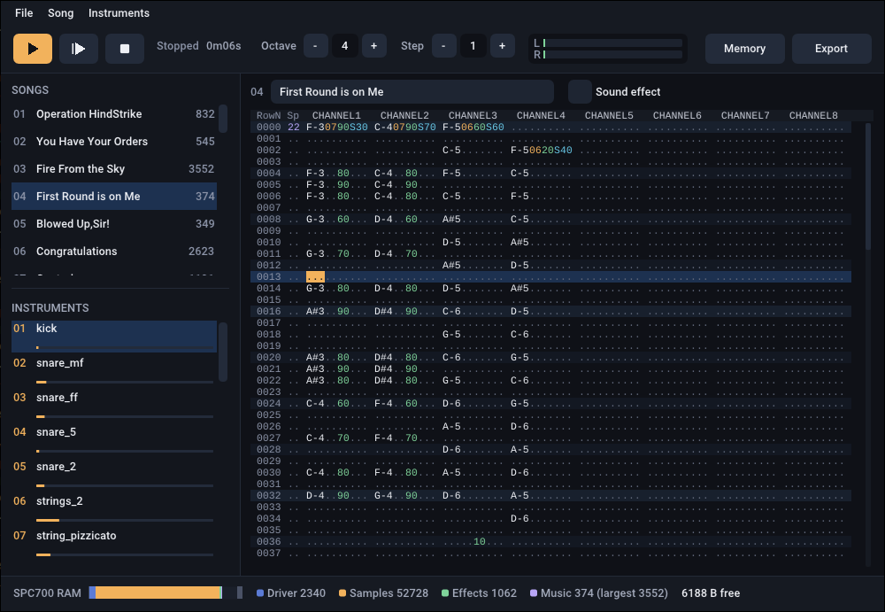

# SNES Game Sound System (or Solution)



A music and sound effects editor for SNES homebrew games, with its sound
driver.

## Version history

- **v1.51** 03.11.26 – the interface scales to the display. View > Zoom
  (Ctrl+= / Ctrl+-) makes it bigger or smaller and saves preferences.
- **v1.50** 03.11.26 – new editor for Windows, Linux and macOS, replacing the
  Borland one (kept in `legacy/`); same projects and byte-identical exports.
  One-window workspace with drag-and-drop song and instrument lists. 
  Edits are heard while the song plays, and the cursor follows it.
  XM import brings in samples, envelopes, tempo and effects. 
  Imports add songs instead of overwriting.

The original `snesgss.exe`:


- **v1.43** 11.10.26 – SPC700 driver fix for deadlock in the command handshake
- **v1.42** 20.02.17 – Instrument selection in the main menu
- **v1.41** 25.05.14 – MIDI input device can be changed in the config file
- **v1.4** 24.05.14 – paste over; shifting markers and labels in multichannel Expand/Shrink; MIDI input support
- **v1.31** 03.04.14 – song duration estimate, displayed in the window header
- **v1.3** 02.04.14 – Output monitor and built-in tuner; minor fixes
- **v1.23** 01.04.14 – SPC700 driver fix to remove noise burst on initialize heard on the real HW and latest snes9x versions
- **v1.22** 30.03.14 – sections list for easier navigation
- **v1.21** 06.03.14 – volume scale dialog, minor fixes and improvements
- **v1.2** 26.12.14 – volume column added, Vxx effect removed; Mxy renamed to Vxy, old modules will be converted automatically; panning support; optional sample loop unrolling for better quality
- **v1.11** 24.12.14 – FamiTracker text import feature
- **v1.1** 07.09.14 – improvements to the order-less design
- **v1.02** 25.08.14 – minor fixes, SPC700 driver improvements
- **v1.01** 18.08.14 – important bug fixes, more features, transpose dialog
- **v1.0** 15.08.14 – first release version, with all planned features
- 22.07.14 – development of the new system has started
- ~06.11 – the old system, including spcbank, xm2data, and SPC700 code; the new system is based on its parts.

## About

The sole purpose of this software is to make music and sound effects for
SNES homebrew games. It is not meant to be a stand-alone music authoring
software in any way.

The editor is fully interactive. Heard while the song plays: a change to the 
notes, effects, speeds, instruments or channel mutes reaches each channel at 
its next note and notes already sounding carry on.

The editor is one window. The toolbar holds the transport, the octave, step
and measure settings, the output levels and the Memory and Export buttons.
The sidebar lists the songs and instruments: click one to show it, drag one
to reorder (songs keep playing the instruments they used), right-click one to
clear or delete it. The main view shows the selected song's pattern (F1), an
instrument (F3) or the SPC700 memory map (F4), and the status bar shows how
much of the SPC700's memory the project uses.

The system architecture uses a single sample bank for every song and
sound effect in a game. The sound driver along with sample bank is fully
loaded at start up. Sound effects created as shorter songs (marked as
sound effect), they also loaded along with the driver. Larger songs are
loaded on a one-by-one basis. It is kind of MIDI concept, music files
only contain notes and commands, while sound bank contains the actual
sounds used by the music files.

## Samples

It is supposed that WAV samples are resampled and looped in an external
audio editor, Wavosaur or similar. The samples should be 16 bit mono,
sampled at 8000, 16000, or 32000 Hz (the latter is preferable), with
melodic content preferably tuned to B (of any octave) +21 cent. In other
words, change pitch of a C-tuned sample 79 cents down. The reason behind
this is the BRR encoding that works with 16 sample blocks, with this
tuning a simple waveform will be a multiple of 16, improving looping
quality. Pitch table is calculated to map the B +21 sampled instrument
to actual C note on the C key, producing the standard tuning. To play
a sample close to its original sample rate, use B key.

## Command line

The editor also works from the command line:

```
snesgss [project.gsm]                                   open the editor
snesgss project.gsm -e [export dir]                     export
snesgss project.gsm -spc <song number> <file.spc>       write a song as an SPC file
snesgss project.gsm -wav <song> <seconds> <file.wav>    render a song to a WAV file
snesgss project.gsm -resave <file.gsm>                  load and save again
```

## Importing

The Song menu imports from XM (FastTracker 2), MIDI and FamiTracker text
exports. An imported song is added after the last song in use, so none is
overwritten, and importing the same file again replaces its song: XM songs
are matched by the XM's own names, MIDI and FamiTracker songs are named after
the file.

Import from XM brings in the notes, the speed and tempo, and the effects the
driver can play: volumes and volume slides, pitch slides, portamento,
vibrato, panning, the order list's jumps and breaks. With Include samples
(on by default) it also brings in each instrument's sample, retuned to play
in tune, and its volume and pan envelopes. The instruments go after the last
one in use, or replace the instruments of the same names, keeping their
envelope, EQ and encoding settings. What the driver can't play (arpeggio,
tremolo, sample offset and so on) is listed after the import.

The Instruments menu imports an SPC bank, and the instrument editor imports
WAV samples.

## MIDI import

The MIDI import supports both format 0 and 1. It expects that notes are
placed in channels 1-8 (or 1-6 plus drum channel), and there is no more
than 1 note in a channel at a time. It imports notes only, with
instrument assigned by the channel number. If the drum channel is
present, it gets imported into SNES channels 7-8, channel 7 is used for
hats, and channel 8 for kick, snare, and toms. Instrument numbers
assigned to different drums are 10 for kick, 11 for snare, 12 for toms,
13 for hats.

## Keys

### General

| Key | Action |
|---|---|
| F1 | Song editor (pattern) |
| F3 | Instrument editor |
| F4 | Memory: the SPC700 memory map |
| Ctrl+= , Ctrl+- | Zoom the interface in and out, 50% to 300% (View menu; remembered) |

The songs and instruments are listed in the sidebar. The interface follows
the display's scaling; View > Zoom makes it bigger or smaller on top of that,
and View > Actual Size returns to 100%. On a Mac, Cmd works as Ctrl.

### Song editor

| Key | Action |
|---|---|
| Up, Down | Move the cursor one row up/down |
| PgUp, PgDown | Move the cursor one page up/down, the page size is set in the config file |
| Left, Right | Move the cursor between columns |
| Tab, Shift+Tab | Move the cursor between the same columns of the channels |
| Numbers | Enter a number value (speed, instrument number, effect value) |
| Note keys | Enter a note in the song editor (and hear its row, unless the song is playing), or play a note in the instrument editor |
| Delete | Delete a note, a number, or selection without shifting other notes |
| Backspace | Delete a note field, shifting everything below and moving the cursor up |
| Insert | Insert a blank note field, shifting everything below down |
| Ctrl+F | Find section, shows list of all named and unnamed sections of the song |
| Ctrl+G | Edit current row number, to navigate through the song faster. Pressing Enter returns the cursor back to the position where it was originally |
| Ctrl+1..8 | Toggle channel mute |
| Ctrl+0 | Toggle solo mode for current channel |
| [ ] | Change auto step, 0 to 16 |
| Numpad / * | Change octave, 1 to 8 |
| Numpad 1..8 | Set octave |
| F5 | Play song from beginning |
| F7 | Play song from current row |
| F8 | Stop playing |
| Enter | Hold down to play from current row |
| Space | Set section break on current row |
| Home | Go to previous section |
| End | Go to next section |
| \` | Enter section name, only used for easier navigation (see Ctrl+F) |
| Ctrl+[ ] | Change measure, each song has its own measure |
| Ctrl+Home | Set loop position (the row that will be played after loop) |
| Ctrl+End | Set song length (the last actual row) |
| Ctrl+Z | Undo last change in the song text, one step |
| Shift+Cursor | Set block selection for block functions |
| Ctrl+A | Select all channels, all fields. First key press selects current section (if any), next key press selects the whole song length |
| Ctrl+L | Select current channel, all fields, section or whole song |
| Ctrl+X | Cut selection |
| Shift+X | Cut selection and shift the rows below up |
| Ctrl+C | Copy selection |
| Ctrl+V | Paste selection |
| Shift+V | Paste selection and shift existing rows down |
| Ctrl+B | Paste selection over existing content |
| Ctrl+F1 | Transpose selection semitone down |
| Ctrl+F2 | Transpose selection semitone up |
| Ctrl+F3 | Transpose selection octave down |
| Ctrl+F4 | Transpose selection octave up |
| Ctrl+E | Expand selection |
| Ctrl+S | Shrink selection |
| Numpad + - | Switch between sub songs |

### Mouse

Clicking on the pattern header changes the channel mute setting.
Left click toggles the mute for a channel, right click toggles the solo mode for a channel.

Click left mouse button and move the mouse while holding the button to make a block selection.

Double click on a channel selects a section in that channel; if the Shift key is down, it
selects the whole song length.

### Note keys

`1` or `A` is the rest note.

Current octave:

```
 S D   G H J   L :
Z X C V B N M < > ?
```

Next octave:

```
 2 3  5 6 7  8 9
Q W E R T Y U I O P
```

## Pattern

### Row fields

```
RRRR SS [CH1..CH8]
```

- **RRRR** is the row number
- **SS** is speed, could be set per row, 1 to 99 (fastest to slowest, default is 20).
- **CH1..CH8** are note fields, see below

### Note fields

```
C#3iiVVEvv
```

- **C** is note (# sharp)
- **ii** is the instrument number, 1..99
- **VV** is the volume, 0..99 (lowest to highest)
- **E** is the effect name
- **vv** is the effect value, only editable if the effect is specified

### Effects

All effect values are decimal, in 0..99 range.

All effects applied to the channel continuously. To turn off an effect other than the pan,
use it with 00 as value.

| Effect | Description |
|---|---|
| Txx | (de)Tune, sets constant pitch offset that is applied to all following notes |
| Uxx | Slide Up, 0 is none, 1 is slowest, 99 is fastest |
| Dxx | Slide Down |
| Pxx | Portamento, 0 is none, 1 is slowest, 99 is fastest; has priority over the Slide. P99 is legato mode, pitch changes instantly, like on a new note, but without key on |
| Sxx | Pan, 0 is the leftmost, 50 is the center, 99 is the rightmost positions |
| Vxy | Vibrato, x is speed (1 slowest, 9 fastest), y is depth (1 min, 9 max) |
| R.. | Repeat, it repeats previous section in current channel, from beginning of the section |

## Export and use

When all music and sound effects created, the project can be exported
(File > Export, or the Export button) for further use in a SNES program.
The editor exports a number of files:

| File | Contents |
|---|---|
| `spc700.bin` | contains compiled SPC700 driver code, samples, sound effects data. This means you don't need to use a SPC700 assembler. |
| `music_N.bin` | contains music data. Each sub song that is not marked as a sound effect will be exported into separate file. This allows to save room for more sample data, while music data is only loaded when needed. |
| `sounds.asm` | contains incbin's in the WLA DX format, considering LoROM configuration. |
| `sounds.h` | contains automatically generated aliases for every sub song and sound effect, as well as sub song names. |

The latter two files aren't necessary, they meant to be used in a specific
SNES dev environment. The interfacing part of the environment is provided
along with the editor in the `/snes/` directory, it consist of two files,
`sneslib.asm` and `sneslib.h`. There are 65816 assembly functions to load the
SPC700 driver and communicate with it, as well as C interface to these
functions.

You can either adapt provided code for your purposes, or create a new one,
using the code as a guide. `spc700.bin` loading and starting address is
$0200. When the driver is loaded, communication is done through APU ports
using the communication routines (see `snes/sneslib.asm:542` and beyond).
Driver loading code is in `snes/sneslib.h:774`. 'Play a sound effect'
function is in `sneslib.asm:830`, it also uses `spc_command_asm` routine
(uniform for most commands), which is in `sneslib.asm:636`.

The `spc700.asm` file in the `/snes/` directory is only provided for reference,
in case you're interested in internals of the driver. It does not need to
be compiled or otherwise used in a SNES program.

Take a note that, unlike the editor or exported SPC file, driver starts in
mono mode, for compatibility reasons, as many old TV sets does not have
stereo, and some part of the sound would be missing. To get stereo output,
the stereo enable command must be sent first.

## Notes

> **Warning:** keep samples below full volume. A sample that peaks at the very
> top of its range can click on a real SNES and in accurate emulators, even
> though it sounds clean in the editor. If you hear one, lower the instrument's
> Vol slider in the instrument editor a little (128 to 112 is usually enough)
> and export again. Don't normalize samples to 0 dB or boost them hard with the EQ.


## Building Editor

The editor in `app/` is a rewrite of the original `snesgss.exe` for Windows,
Linux and macOS (SDL3 and Dear ImGui). It reads and writes the same `.gsm`
projects, and its exports are byte for byte those of `snesgss.exe` v1.43.
See [app/BUILDING.md](app/BUILDING.md) to build it. The original editor, its
release archive and its Borland C++ Builder source are kept in
[legacy/](legacy/).


## Music data format

### Header

```
+0 1 how many channels in the song
+1 2 absolute address of the first channel
+3 2 absolute address of the second channel (if exists)
...
```

### Channel

Series of bytes interpreted as follows:

```
  0..148       short delay
149..244       note in semitones (C-1..B-8)
     245       keyoff
     246,L,H   long delay, followed with two bytes of the delay duration, up to 65535
247..253       song effects:
     247,V     volume, byte of the volume is 0..127
     248,P     pan, byte of the pan is 0..255 (128 is center)
     249,D     detune, byte of the detune
     250,S     slide up or down, byte of the slide is signed -99..99
     251,P     portamento, byte of the slide is 0..99
     252,M     vibrato, byte of the vibrato parameters (high nibble is depth 0..9, low nibble is speed 0..9)
     253,L,H,C reference, next three bytes are reference absolute address and reference length (0..255 bytes)
     254,I     instrument change, followed with byte of the instrument number 0..99
     255,L,H   loop, followed with two bytes of absolute address of the loop point
```
